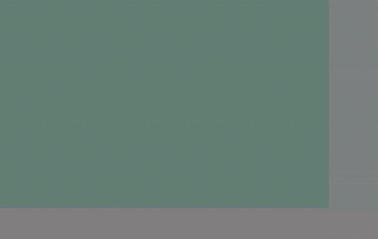
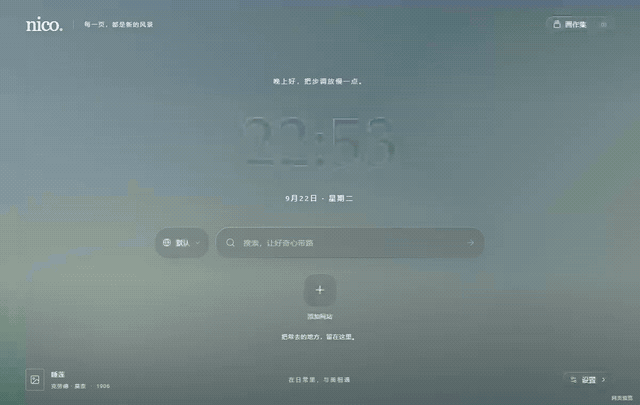

<div align="center">

# Nico · 印象新标签页

**在印象派画作与轻盈玻璃之间，开始新的浏览。**

[Chrome / Edge 120+](https://developer.chrome.com/docs/extensions/develop/migrate/what-is-mv3) · [nico-glass-kit](https://github.com/more-nico/nico-glass-kit) · 本地优先 · MV3

</div>

<p align="center">
  
</p>

---

## 目录

- [这是什么](#这是什么)
- [亮点](#亮点)
- [安装](#安装)
- [使用](#使用)
- [玻璃材质](#玻璃材质)
- [动态图演示](#动态图演示)
- [开发](#开发)
- [测试策略](#测试策略)
- [数据、权限与限制](#数据权限与限制)
- [项目结构](#项目结构)
- [素材与许可](#素材与许可)

## 这是什么

Nico 是一个 Chrome / Edge 新标签页扩展：用时间、搜索和常用网站承接下一次浏览，用莫奈画作和可交互的玻璃材质让空白页保留一点风景。

它是一个本地优先的 MV3 扩展。设置、快捷网站和上传的壁纸默认都留在浏览器本地，没有 Nico 账号、后台服务、遥测或云端同步；需要多设备时，可以选择连接自己的坚果云账号做同步。

## 亮点

- **整页响应式布局。** 以动态视口高度组织页头、时钟、搜索、快捷网站和页脚；常见桌面尺寸尽量一屏显示，内容过多时自然滚动。
- **真正的玻璃材质。** 首页和弹窗基于 [`nico-glass-kit`](https://github.com/more-nico/nico-glass-kit)，支持折射、边缘高光、指针弹性和自动明暗判断。
- **可降级的渲染档位。** “细腻”档启用折射、色散和弹性；“轻盈”档回退到普通 CSS 背景链。浏览器能力不足或系统减少动态效果时会自动降级。
- **搜索留在原位。** 支持浏览器默认引擎、Google、Bing、百度、DuckDuckGo 和自定义引擎；搜索结果在新标签页打开，当前新标签页不被替换。
- **本地壁纸与备份。** 三幅内置画作可离线显示；上传图片会在本地压缩为 WebP；设置页可导出和导入完整 JSON 备份。
- **可选的坚果云同步。** 用坚果云账号和第三方应用密码（WebDAV）把常用网站与全部设置同步到自己的坚果云；支持手动上传、从云端恢复和自动同步，凭据只留在本机、不写进备份。
- **快捷网站可整理。** 支持拖拽排序、编辑、删除、网站图标、右键编辑，以及从浏览器工具栏直接添加当前网站。

## 安装

需要桌面版 Chrome / Edge 120 或更高版本。

1. 下载并解压 `release/nico-newtab-1.0.0.zip`，或使用构建后的 `dist/` 文件夹。
2. 打开 `chrome://extensions` 或 `edge://extensions`。
3. 开启“开发者模式”，点击“加载已解压的扩展程序”。
4. 选择包含 `manifest.json` 的 `dist/` 文件夹。
5. 新建标签页并确认使用 Nico；已有其他新标签页扩展时，需要停用其中一个。

更新扩展后，在扩展管理页点击“重新加载”，再打开新的标签页。请保持已加载的文件夹路径不变，这样可以保留扩展标识和本地数据。

## 使用

### 搜索

搜索栏左侧可以切换搜索引擎。Google、Bing、百度和 DuckDuckGo 支持联想词：输入两个字符后，用 ↑ / ↓ 选择，回车搜索，Esc 关闭。浏览器默认引擎和自定义引擎不请求联想接口；离线或请求失败时列表自动隐藏。

### 快捷网站

点击“添加网站”填写名称和 HTTP/HTTPS 地址。点击网站会在新标签页打开；“整理”、图标上的省略号或右键可以编辑、删除和调整顺序。可上传 JPG、PNG 或 WebP 图标，图片会在本地裁成方形并压缩到 128 像素。

工具栏上的 Nico 图标可以把当前标签页的标题、网址和图标带入添加面板。扩展页、`chrome://` 页面和本地文件没有可访问的网址，因此不会被添加。

### 壁纸与外观

右上角“画作集”可以切换三幅内置画作；上传 JPG、PNG 或 WebP 后会出现“我的图片”。图片在本地转换为长边不超过 2560 像素的 WebP，旧图片只有在新图片保存成功后才会替换。

右下角“设置”包含：

- 壁纸铺满 / 完整显示、位置、亮度和模糊；
- 玻璃明暗：自动、浅色、深色；
- 玻璃档位：轻盈、细腻；
- Blur、Saturation、Brightness、Map scale、Depth、Curvature、Dispersion、Highlight、Elasticity；
- 12 / 24 小时制和自定义搜索引擎；
- JSON 备份导出与导入。

### 坚果云同步

Nico 不提供自己的账号服务。需要多设备同步时，可以用坚果云账号接入：在设置 → 同步里填写坚果云 WebDAV 地址、账号和第三方应用密码即可。同步内容与“导出备份”相同，包含常用网站、全部外观设置和上传的自定义壁纸。

生成第三方应用密码：登录[坚果云网页端](https://www.jianguoyun.com/) → 右上角账户名 → 账户信息 → 安全选项 → 第三方应用管理 → 添加应用密码。**这里要用应用密码，不是坚果云登录密码。** 详细步骤见[坚果云接入手册](https://help.jianguoyun.com/?p=2064)。

- 服务器地址固定为 `https://dav.jianguoyun.com/dav`，同步文件保存为 `nico-newtab/nico-newtab.json`。
- 首次连接时，如果云端已有备份，Nico 会让你选择用云端覆盖本机，或用本机覆盖云端。
- 连接后可手动“立即同步”“上传本机”“从云端恢复”，也可以打开“自动同步”：本机改动会在几秒后自动上传，打开新标签页时最多每 10 分钟检查一次云端更新。
- 本机与云端都有改动时不会自动覆盖，会提示你手动选择保留哪一份。
- 账号与应用密码只保存在本机扩展存储中，不会写进导出的 JSON 备份；断开连接会一并清除。

> 坚果云免费账号对 WebDAV 有请求频率和流量限制（例如每 30 分钟 600 次请求），自动同步已经做了防抖和节流。具体限制以[官方说明](https://help.jianguoyun.com/?p=2064)为准。

## 玻璃材质

Nico 使用 [`nico-glass-kit`](https://github.com/more-nico/nico-glass-kit) 的共享玻璃表面与 `GlassLightGroup`。`overLight="auto"` 会根据玻璃下方实际绘制的背景判断文字、染色、边缘和阴影的明暗；设置为浅色或深色时可以固定结果。

| 档位 | 行为                                                                              |
| ---- | --------------------------------------------------------------------------------- |
| 轻盈 | 普通 CSS `backdrop-filter` 链，关闭高成本折射与弹性；也是减少动态效果时的回退档。 |
| 细腻 | 启用 SVG 位移折射、色散、指针弹性和悬停高光；不支持完整折射时仍会沿回退链降级。   |

当前默认材质参数与 kit Playground 保持一致：Blur `3px`、Saturation `100%`、Brightness `1.10`、Map scale `20%`、Depth `8px`、Curvature `0.20`、Dispersion `10%`、Highlight `100%`、Elasticity `0.20`。

## 动态图演示

动态图由 `scripts/record-demos.mjs` 使用 Playwright 录制，再由 FFmpeg 转换为 GIF。它们是文档素材，不属于测试烟测。

**首页玻璃交互**：指针经过时钟、搜索栏和快捷入口，观察边缘高光与弹性。

<p align="center">
  
</p>

**设置面板**：打开设置，在外观、功能和关于页之间切换，再关闭弹窗。

<p align="center">
  
</p>

**快捷网站**：多个网站瓷贴的指针反馈和玻璃高光。

<p align="center">
  
</p>

重新录制素材：

```powershell
npm run dev
npm run record:demos
```

脚本默认访问 `http://127.0.0.1:4173`，也可以用 `PREVIEW_URL` 指定预览地址。录制需要 Chromium 和 PATH 中可用的 `ffmpeg`。

## 开发

```powershell
npm ci
npm run dev          # Vite 预览：http://127.0.0.1:4173
npm run test:quick   # 单元测试 + TypeScript 类型检查
npm run build        # 构建可加载的 dist/ 扩展
npm run record:demos # Playwright 录制文档 GIF
npm run mock:webdav  # 本地模拟坚果云 WebDAV，供网页预览联调同步
npm run test:full    # 提交或打包前的完整检查
npm run package      # 构建并生成 release/nico-newtab-1.0.0.zip
```

预览页面使用独立的 `localStorage` / IndexedDB，与扩展数据不互通。预览中提交搜索只显示提示，不会真正跳转；预览没有扩展的跨源权限，因此不会出现搜索建议。

网页预览同样不能跨域访问真实的坚果云 WebDAV。联调同步面板时先运行 `npm run mock:webdav`，然后在同步设置里填服务器地址 `http://127.0.0.1:8787/dav`、账号 `demo@example.com`、应用密码 `demo-app-password`；上传的文件保存在 `.cache/mock-webdav/`。真实坚果云账号需要把扩展加载到 Chrome / Edge 后再测。

## 测试策略

日常修改、普通 bug 修复和小功能使用 `npm run test:quick`。UI-only 调整使用最小的专项验证，可以运行 `scripts/inspect-ui.mjs`、`scripts/preview-smoke.mjs` 或一次性 Playwright 脚本。

`scripts/smoke.mjs` 只保留跨浏览器、跨扩展边界且值得长期回归的流程：MV3 加载、CSP、存储同步、输入行为和浏览器重启持久化。一次性的视口矩阵、截图检查和布局探索不放进这里。

提交或打包前运行：

```powershell
npm run test:full
```

它会先构建扩展，再在独立的 Chrome / Edge 配置中运行完整烟测。详细约定见被仓库使用的 `AGENTS.md`。

## 数据、权限与限制

- 设置和网站列表保存在 `chrome.storage.local` 的 `nico.newtab.state.v1`。
- 上传壁纸保存在扩展独立 IndexedDB；导出备份时会以内嵌 WebP 数据带出。
- 坚果云同步的账号、第三方应用密码、同步目录和上次同步信息单独保存在 `chrome.storage.local` 的 `nico.newtab.sync.v1`，不会写进导出的 JSON 备份。账号和密码以明文保存在本机扩展存储中，请只在可信设备上开启同步；断开连接会清除它们。
- 开启同步后，只有在连接、上传或下载时才会把备份 JSON 发送到 `https://dav.jianguoyun.com/dav`；不开通同步时扩展不会访问任何账号服务。
- 只申请 `storage`、`search`、`favicon`、`activeTab` 和 `tabs` 权限，以及四个搜索建议接口和坚果云 WebDAV 的 `host_permissions`。
- 不读取浏览历史，不注入网页脚本，没有 Nico 账号、后台服务或遥测。
- 搜索建议需要网络；网站图标可能因目标网站不提供 favicon 而退回首字母。
- 隐私 / 无痕窗口不支持新标签页替换。
- 卸载扩展会删除本地扩展数据，建议先导出备份。

## 项目结构

```text
src/components/   设置、网站编辑、弹窗和搜索引擎管理
src/lib/           校验、持久化、图片处理、平台适配、玻璃材质、坚果云同步
src/popup/         浏览器工具栏添加网站的小面板
src/App.tsx        新标签页首页与交互
public/            MV3 manifest、画作、缩略图、图标和第三方说明
assets/            README 动态演示 GIF
scripts/           资源处理、构建打包、预览检查、烟测、GIF 录制和 WebDAV 模拟
docs/              坚果云同步的接入与实测说明
```

## 素材与许可

三幅内置画作来自芝加哥艺术博物馆公开作品信息和 Wikimedia Commons 公有领域复制图；来源、许可证和处理说明见 [`public/THIRD_PARTY_NOTICES.md`](public/THIRD_PARTY_NOTICES.md)。

`nico-glass-kit` 依赖采用 MIT License；本项目使用的画作与运行时依赖以第三方说明为准。`assets/` 中的 GIF 是用本地页面和本项目内置壁纸录制的演示素材。
