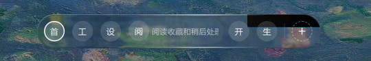

# 缺陷报告：高档玻璃在动态宽度下出现不透明黑块

> 初次调查日期：2026-10-22。原始受测版本：`nico-glass-kit@0.3.2`。最新更新：2026-10-23，`0.4.0` 发布包已通过 Dock、尺寸同步和 Worker 兼容性复验。`0.3.3`、`0.3.4` 的历史修复及测试记录保留在文末各节。

## 摘要

Nico 新标签页的 Dock 在鼠标快速划过、标签展开收起时，会短暂出现不透明黑色长条。已在启用 Metal 硬件加速的 Edge Canary 中复现，网页预览和真实 MV3 扩展均受影响。

目前确认了两个相关问题：

1. **尺寸失配已观察到**：Dock 标签使用 300ms 宽度动画，`GlassSurface` 在尺寸停止变化 100ms 后才更新几何数据。动画期间，容器曾从约 306px 展开到 422px，而当前 SVG 折射贴图仍使用 306px 的宽度。
2. **透明度处理缺陷已验证**：RGB 色散拆分使用的三个 `feColorMatrix` 都将输出 alpha 强制设为 1，会把透明黑转换为不透明黑。仅将这些矩阵改为保留输入 alpha，快速滑动测试中的黑块即消失；仅关闭弹性仍能复现。

尺寸失配如何在 Chromium 的具体中间缓冲区中产生透明采样，仍需进一步追踪。下面将已验证事实与机制推断分别列出，避免把它归结为单纯的 GPU 性能不足。



上图为硬件加速网页预览的实际复现截图裁剪，保留了原始黑块。

## 受测环境

| 项目         | 实测值                                                                                                                                 |
| ------------ | -------------------------------------------------------------------------------------------------------------------------------------- |
| 玻璃库       | `nico-glass-kit@0.3.2`                                                                                                                 |
| 宿主项目     | Nico，React 19 / TypeScript / Vite，Manifest V3 扩展                                                                                   |
| 宿主源码基线 | [`cbe48faf938ff52ec2bf561f489d359cd477351a`](https://github.com/more-nico/nico-newtab/commit/cbe48faf938ff52ec2bf561f489d359cd477351a) |
| 浏览器       | Microsoft Edge Canary `158.0.4354.0`                                                                                                   |
| 系统         | macOS `27.0.1`，Build `26A434`                                                                                                         |
| GPU          | Apple M4，ANGLE Metal Renderer                                                                                                         |
| 合成状态     | CDP `SystemInfo.getInfo` 返回 `gpu_compositing: enabled`、`rasterization: enabled`                                                     |
| 页面参数     | 视口 `1440 × 900`，`deviceScaleFactor: 2`，`zh-CN`                                                                                     |
| 页面类型     | Vite 网页预览、通过 `Extensions.loadUnpacked` 加载的真实扩展页面                                                                       |

使用默认《睡莲》壁纸，玻璃质量为 `high`，明暗模式为 `auto`。关键参数为：

```ts
const material = {
  blur: 3,
  saturation: 100,
  brightness: 1.1,
  depth: 8,
  curvature: 0.2,
  dispersion: 0.1,
};
// GlassProvider.lensMapRasterScale = 0.2
// GlassSurface.cornerRadius = 26
// GlassSurface.elasticity = 0.2
// GlassSurface.highlightIntensity = 1
```

以上是受测范围，尚未验证其他操作系统、稳定版浏览器或全部材质参数组合。

## 复现步骤

1. 在上述 Nico 源码基线上运行 `npm ci`、`npm run dev`，打开终端输出的本地预览地址。验证扩展时，运行 `npm run build`，通过浏览器开发者模式加载 `dist/`。
2. 创建以下六个页面，使 Dock 中同时存在长短不同的名称：`首页`、`工作与效率工具`、`设计`、`阅读收藏和稍后处理`、`开发工具`、`生活`。
3. 将玻璃档位设为“细腻”（`high`），保持上述默认材质参数。确保系统未开启“减少动态效果”，以免宿主主动降为低档玻璃。
4. 将鼠标停在 Dock 图标上，观察名称展开。随后在 Dock 左右两侧快速往返移动，持续触发不同标签的展开与收起。
5. 观察 Dock 上缘，特别是右侧新展开区域：可出现短暂的不透明黑色矩形或长条，随后恢复为正常玻璃。

自动化复现时，在初始 Dock 边界内，从 `(left + 3, top + 25)` 移动到 `(right - 3, top + 25)`；向右移动使用 Playwright `mouse.move(..., { steps: 5 })`，反复往返。网页预览对照使用 16 轮，真实扩展使用 12 轮，最后将鼠标移出并等待 600ms。往返过程中不等待标签动画完成。

**预期结果**：宽度变化期间仍能透出背景，不出现不透明黑色区域。

**实际结果**：快速切换悬停目标时，黑块会出现在玻璃层内部。当前定量结果覆盖标签动画引起的宽度变化；连续调整浏览器窗口宽度另列为回归场景。

## 代码位置与机制

### 1. 宽度动画与几何更新不同步：已验证

宿主的 [Dock 标签样式](../src/styles.css)（`.dock-page-label`，调查时第 1167–1189 行）对 `max-width` 和外边距应用 300ms 过渡。Dock 外壳随内容宽度变化；[Dock 组件](../src/App.tsx)将这一外壳直接交给 `GlassSurface` 渲染。

玻璃库的 [`GlassSurface.tsx`](https://github.com/more-nico/nico-glass-kit/blob/main/src/core/GlassSurface.tsx) 在尺寸回调中清除旧定时器，并延迟 100ms 读取 `offsetWidth` / `offsetHeight`。持续变化会不断推迟更新。这是等待变化结束的防抖，而非每 100ms 更新一次。

[`SvgFilterRegistry.tsx`](https://github.com/more-nico/nico-glass-kit/blob/main/src/core/SvgFilterRegistry.tsx) 将已记录的宽高写入 `feImage`，使用 `preserveAspectRatio="none"`。因此，在新几何数据和滤镜就绪前，当前滤镜仍持有旧贴图尺寸。逐帧 DOM 采样已观察到约 116px 的容器与贴图宽度差。

为便于核对发布产物，`0.3.2` 的 `dist/nico-glass-kit.mjs` 对应位置为：

| 位置            | 内容                                        |
| --------------- | ------------------------------------------- |
| 第 1518–1524 行 | `ResizeObserver` 回调中的 100ms 防抖        |
| 第 423–431 行   | `feImage` 使用记录的宽高                    |
| 第 192–193 行   | 编译后的 `lensChannelMatrix`，符号名为 `Mn` |

上游链接指向 `main`，用于定位源文件；受测行为以安装的 `0.3.2` 发布产物为准。

### 2. 色散矩阵将透明区域变黑：已验证

[`lensFilter.ts`](https://github.com/more-nico/nico-glass-kit/blob/main/src/core/lensFilter.ts) 中，非零色散会执行三个位移通道，再分别提取 RGB 并用 `screen` 混合。`lensChannelMatrix` 的红通道矩阵如下，绿、蓝通道的 alpha 行相同：

```text
1 0 0 0 0
0 0 0 0 0
0 0 0 0 0
0 0 0 0 1
```

最后一行使 `A_out = 1`，与输入 alpha 无关。输入 `(0, 0, 0, 0)` 会变成 `(0, 0, 0, 1)`；三个通道的黑色再经 `screen` 混合，仍是不透明黑色。

独立 SVG 实验也验证了这一点：在蓝色背景 `rgb(160, 216, 239)` 上，将滤镜区域延伸至源图形之外。原矩阵在透明区域输出的截图像素为 `[0, 0, 0]`；仅将 alpha 行改为 `0 0 0 1 0`，同一位置显示背景 `[160, 216, 239]`。

这与 [W3C 的 `feColorMatrix` 定义](https://www.w3.org/TR/filter-effects-1/#feColorMatrixElement)一致。规范还说明，滤镜中的未定义像素按透明黑处理，见[滤镜原语概述](https://www.w3.org/TR/filter-effects-1/#FilterPrimitivesOverview)。

### 3. 尺寸失配到透明采样的链路：机制推断

旧 `feImage` 无法覆盖新增区域时，位移输入可能读到透明值或错误的边缘数据；后续位移也可能采样到有效输入范围之外。根据 [`feDisplacementMap` 的公式](https://www.w3.org/TR/filter-effects-1/#feDisplacementMapElement)，R/G 通道为 0 时，位移为 `-scale / 2`，并非零位移。这能解释为何问题集中在宽度变化和边缘位置。

但尚未直接导出 Chromium 的中间滤镜缓冲区，不能确定每次黑块究竟来自贴图覆盖范围、源图像裁剪还是合成缓冲区的哪一环。已验证的是：**尺寸存在滞后，强制不透明的矩阵会把透明区域变黑，修改这三个矩阵足以消除本次采样中的黑块。**

## 对照实验

所有 GPU 对照均使用有窗口的 Edge Canary 和上述背景。通过 CDP `Page.startScreencast` 获取 PNG 帧，在 Dock 所在区域计数 RGB 三个分量都小于 25 的像素；一帧超过 10 个这样的像素即计为“检测到黑块的帧”，并检查最严重帧的截图。该阈值针对当前背景用于辅助识别，不是通用视觉检测标准。

| 环境     | 唯一干预                   | 检测到黑块的帧 / 采样总帧 |
| -------- | -------------------------- | ------------------------- |
| 网页预览 | 原始版本                   | **123 / 164**             |
| 网页预览 | 三个色散矩阵保留输入 alpha | **0 / 141**               |
| 网页预览 | 仅将 `elasticity` 设为 0   | **113 / 141**             |
| 真实扩展 | 原始版本                   | **5 / 119**               |
| 真实扩展 | 三个色散矩阵保留输入 alpha | **0 / 103**               |

修正矩阵的实验通过测试页面中的 DOM 修改完成：修改现有矩阵，并在创建新滤镜时继续应用同一修改。未改变宽度动画、尺寸防抖、色散强度或弹性设置。该实验验证了候选修复的效果，尚不能代替库补丁的完整回归。

**每行都是一次独立采样，不是稳定发生率。** 截帧时序和实际帧数不同，不能据此比较网页预览与扩展谁更容易出问题；`0` 也只表示该次采样未观察到黑块。

普通无头测试使用软件合成：Chromium `153.0.8010.12` 的 CDP 状态为 `gpu_compositing: disabled_software`、`rasterization: disabled_software`。该路径未稳定复现原始黑块，因此不能以普通 headless 截图通过作为修复依据。

## 建议修复

### 优先修复三个通道矩阵的 alpha 行

将 `lensChannelMatrix` 改为保留各自位移结果的 alpha；RGB 提取逻辑保持原样：

```ts
export function lensChannelMatrix(channel: "r" | "g" | "b"): string {
  if (channel === "r") {
    return "1 0 0 0 0  0 0 0 0 0  0 0 0 0 0  0 0 0 1 0";
  }
  if (channel === "g") {
    return "0 0 0 0 0  0 1 0 0 0  0 0 0 0 0  0 0 0 1 0";
  }
  return "0 0 0 0 0  0 0 0 0 0  0 0 1 0 0  0 0 0 1 0";
}
```

核心变化是将每个矩阵最后一行从 `0 0 0 0 1` 改为 `0 0 0 1 0`，即 `A_out = A_in`。该改动不需要调整公开 API、材质参数或宿主的 Dock 动画。

由于部分透明输入也会受影响，应同时检查三通道 `screen` 合成后的 alpha、边缘色彩与背景衔接。当前实验支持这一候选修复，最终实现仍需由库维护者完成回归确认。

### 后续改进动态尺寸同步

修复 alpha 后，旧尺寸贴图仍可能短暂产生折射位置偏差。建议单独处理持续 resize 期间的几何一致性：评估每帧合并测量、过渡期间的贴图映射或安全回退，并确保切换到新滤镜时引用有效。

不建议仅凭本报告取消 100ms 防抖、对每次 resize 都完整生成 PNG；应先测量持续缩放下的主线程耗时和滤镜重建频率。关闭弹性未消除黑块，不应作为修复方案。

## 建议回归验收

| 场景                                   | 验收重点                                             |
| -------------------------------------- | ---------------------------------------------------- |
| 三个通道分别输入完全透明和部分透明像素 | 通道提取保留输入 alpha；透明区域不会被填成不透明黑色 |
| 三通道合成与玻璃边缘                   | 检查最终合成 alpha、色彩和边缘衔接，不只验证单个矩阵 |
| `dispersion = 0` 与非零色散            | 单通道折射和 RGB 色散两条路径均正常                  |
| 快速展开、收起和中途反向切换           | 使用长短不同的标签连续往返，观察上缘和新增区域       |
| 连续调整窗口宽度、触发 Dock 宽度上限   | 检查几何滞后、滤镜切换及最终尺寸恢复                 |
| `elasticity = 0` 与默认值              | 两种设置下均无黑块，并保留对应的交互行为             |
| 真实扩展与硬件加速浏览器               | 重跑本报告操作；除自动检测外检查截图和实际交互       |

建议将透明输入测试作为确定性的回归保障，将 GPU 动态交互作为浏览器验证。后者应记录浏览器完整版本与 GPU 状态；普通软件合成测试只能作为补充。

## 0.3.3 发布包复验

复验日期：2026-10-22。该轮复验将 Nico 依赖最低版本更新为 `^0.3.3`，锁文件实际安装 `0.3.3`，并重新构建真实扩展。此次验证直接使用 npm 发布包，以下六个场景均未修改运行时矩阵或宿主动画。

### 发布包核对

`0.3.3` 的 `dist/nico-glass-kit.mjs` 第 216–217 行中，三个色散通道矩阵的 alpha 行均为 `0 0 0 1 0`。实际页面中的 Dock 也使用这三个保留 alpha 的矩阵；采样时玻璃档位为 `high`，三个位移通道均存在，未通过降级画质规避问题。[上游 0.3.3 更新说明](https://github.com/more-nico/nico-glass-kit/blob/main/CHANGELOG.md)也列出了该修复。

尺寸更新仍保留 100ms 防抖，位于同一发布产物的第 1855–1861 行。复验期间仍能观测到贴图与容器的尺寸差，但未再次出现原先的不透明黑块。因此，本次结论是黑块缺陷在受测场景中已修复；动态尺寸下折射几何的实时一致性仍是独立改进项。

### GPU 交互结果

环境沿用 Edge Canary `158.0.4354.0`、Apple M4 / Metal、DPR 2，确认 `gpu_compositing` 和 `rasterization` 均为 `enabled`。快速滑动场景使用原来的六个长短名称页面，先让长标签展开 180ms，再连续快速往返；连续缩放场景使用 20 个页面，使 Dock 触及宽度上限，浏览器宽度在 360–1440px 之间反复变化。

| 页面类型 | 场景                   | 弹性  | 检测到黑块的帧 / 有效采样帧 |
| -------- | ---------------------- | ----- | --------------------------- |
| 网页预览 | 标签展开与快速往返滑动 | `0.2` | **0 / 152**                 |
| 网页预览 | 标签展开与快速往返滑动 | `0`   | **0 / 162**                 |
| 真实扩展 | 标签展开与快速往返滑动 | `0.2` | **0 / 123**                 |
| 真实扩展 | 标签展开与快速往返滑动 | `0`   | **0 / 110**                 |
| 网页预览 | 连续调整窗口宽度       | `0.2` | **0 / 34**                  |
| 真实扩展 | 连续调整窗口宽度       | `0.2` | **0 / 41**                  |

六个场景合计 **622 个有效采样帧，未检测到黑块**，页面未出现 JavaScript 运行错误。按每帧最近的 DOM 几何采样定位 Dock，沿用 RGB 分量小于 25、超过 10 个像素的统计，并额外检查 Dock 上缘以排除窄屏内容颜色的干扰；两项统计均为 0。已检查截图中的玻璃、文字和缩放结束后的布局。

为确认检测仍能识别旧缺陷，在独立测试页中，仅将 `0.3.3` 的三个色散矩阵临时恢复为旧版 `A_out = 1`：相同滑动操作下，**149 帧中有 127 帧检测到黑块**，其中 125 帧在上缘检测区命中，并在截图中复现了原来的黑色长条。该项是主动重新引入缺陷的阳性对照，不是未经修改的 `0.3.3` 表现。

以上仍是单次场景采样，不能外推为所有浏览器和材质参数组合均已验证，也不用于比较版本发生率。

### 宿主回归结果

- `npm run test:quick`：13 个测试文件、115 项单元测试及 TypeScript 检查通过。
- `BROWSER_EXECUTABLE='/Applications/Microsoft Edge Canary.app/Contents/MacOS/Microsoft Edge Canary' npm run test:full`：构建和 Edge Canary 扩展冒烟测试通过。
- 使用 Playwright 已安装的 Chrome for Testing 运行 `npm run test:e2e`：扩展冒烟测试通过，浏览器版本为 `Chrome/153.0.8010.12`。

两种浏览器的冒烟测试均覆盖加载、网站编辑、跨标签页同步、备份恢复、搜索、文件夹拖动、重启持久化和工具栏添加。硬件加速黑块专项结论来自上述有窗口的 Edge Canary 测试。

## 0.3.4 发布包复验

复验日期：2026-10-22。该轮 Nico 的依赖最低版本为 `^0.3.4`，锁文件实际安装 `0.3.4`，扩展已重新构建。该轮继续使用未打补丁的 npm 发布包和相同的宿主动画、材质与 GPU 环境。

### 此次更新与新增检查

根据[上游 0.3.4 更新说明](https://github.com/more-nico/nico-glass-kit/blob/main/CHANGELOG.md)，此次修复移除了 100ms 尺寸防抖，并在连续宽高变化时于绘制前同步几何数据，同时保留私有滤镜的身份和动画通道。

已核对安装产物：`dist/nico-glass-kit.mjs` 第 1888–1898 行中的尺寸回调直接读取 `offsetWidth` / `offsetHeight`，通过 `react-dom` 的 `flushSync` 更新尺寸，不再使用 100ms 定时器。三个色散矩阵仍保留输入 alpha；`GlassSurface` 的公开类型与 `0.3.3` 一致。

除了截帧检测黑块，另在 Dock 上注册 `ResizeObserver`，在回调后的微任务中读取容器整数宽高和当前 `feImage` 的宽高，检查两者是否同步；持续记录当前滤镜 ID，检查启用弹性时私有滤镜是否在尺寸变化中保持稳定。`requestAnimationFrame` 中的即时读取可能早于尺寸回调的同步，因此本轮几何验收使用上述回调后的检查值，不将 rAF 瞬时差值当作最终绘制误差。

### GPU 交互结果

六个场景沿用上一轮操作；网页预览使用独立测试端口，真实扩展使用重新生成的构建产物。仍使用 Edge Canary `158.0.4354.0`、Apple M4 / Metal、DPR 2，确认 GPU 合成与栅格化均已启用。

| 页面类型 | 场景                   | 弹性  | 黑块帧 / 有效采样帧 | 尺寸回调后检查次数 | 最大宽高差 |
| -------- | ---------------------- | ----- | ------------------- | ------------------ | ---------- |
| 网页预览 | 标签展开与快速往返滑动 | `0.2` | **0 / 163**         | 221                | **0px**    |
| 网页预览 | 标签展开与快速往返滑动 | `0`   | **0 / 150**         | 217                | **0px**    |
| 真实扩展 | 标签展开与快速往返滑动 | `0.2` | **0 / 113**         | 85                 | **0px**    |
| 真实扩展 | 标签展开与快速往返滑动 | `0`   | **0 / 129**         | 52                 | **0px**    |
| 网页预览 | 连续调整窗口宽度       | `0.2` | **0 / 40**          | 12                 | **0px**    |
| 真实扩展 | 连续调整窗口宽度       | `0.2` | **0 / 37**          | 12                 | **0px**    |

合计 **632 个有效采样帧未检测到黑块，599 次尺寸回调后检查均匹配**。四个启用弹性的场景中，每个场景始终使用同一个私有滤镜 ID，滑动时弹性变换仍正常运行。关闭弹性的共享滤镜也通过尺寸和有效引用检查；其 ID 可以随几何变化切换。所有场景均未观测到滤镜引用缺失或页面 JavaScript 错误，并检查了截图中的正常玻璃、文字与最终布局。

该结果支持 `0.3.4` 在受测 Dock 场景中同时解决原黑块和 100ms 几何更新滞后的问题。帧数及尺寸检查次数均为该轮单次采样，不构成其他平台、全部参数组合或性能提升的保证。

### 宿主回归结果

- `npm run test:quick`：13 个测试文件、115 项单元测试及 TypeScript 检查通过。
- 指定 Edge Canary 执行 `npm run test:full`：构建和真实扩展冒烟测试通过，浏览器版本为 `Edg/158.0.4354.0`。
- 指定 Playwright 已安装的 Chrome for Testing 执行 `npm run test:e2e`：真实扩展冒烟测试通过，浏览器版本为 `Chrome/153.0.8010.12`。

## 0.4.0 发布包复验

复验日期：2026-10-23。当前 Nico 依赖最低版本为 `^0.4.0`，锁文件实际安装 `0.4.0`，真实扩展已重新构建。使用原样 npm 发布包，延续宿主现有的玻璃接入方式、动画和材质设置。

[上游 0.4.0 更新说明](https://github.com/more-nico/nico-glass-kit/blob/main/CHANGELOG.md)新增可选的 `GlassRenderGroup`、共享的双 Worker 光栅化队列，以及私有光学图的原位更新。已核对 `GlassSurface` 和 `GlassProvider` 的公开声明与 `0.3.4` 一致。Nico 本轮未新增可选合批接入；除原有 Dock 回归外，重点检查 Worker 在现有 MV3 CSP 下的兼容性。本轮没有进行帧率性能比较。

### GPU 交互结果

继续使用 Apple M4 / Metal、DPR 2、1440 × 900 初始视口；当前 Edge Canary 已更新为 `158.0.4355.0`，确认 GPU 合成与栅格化均已启用。复现操作及尺寸检查时机沿用 `0.3.4` 一节。

| 页面类型 | 场景                   | 弹性  | 黑块帧 / 有效采样帧 | 尺寸回调后检查次数 | 最大宽高差 |
| -------- | ---------------------- | ----- | ------------------- | ------------------ | ---------- |
| 网页预览 | 标签展开与快速往返滑动 | `0.2` | **0 / 147**         | 159                | **0px**    |
| 网页预览 | 标签展开与快速往返滑动 | `0`   | **0 / 131**         | 213                | **0px**    |
| 真实扩展 | 标签展开与快速往返滑动 | `0.2` | **0 / 120**         | 197                | **0px**    |
| 真实扩展 | 标签展开与快速往返滑动 | `0`   | **0 / 131**         | 101                | **0px**    |
| 网页预览 | 连续调整窗口宽度       | `0.2` | **0 / 24**          | 12                 | **0px**    |
| 真实扩展 | 连续调整窗口宽度       | `0.2` | **0 / 25**          | 12                 | **0px**    |

合计 **578 个有效采样帧未检测到黑块，694 次尺寸回调后检查均匹配**。四个启用弹性的场景中，私有滤镜 ID 均保持稳定。所有场景均未观测到滤镜引用缺失或页面 JavaScript 错误；已检查真实扩展截图中的玻璃时钟、Dock 和文字。

### Worker 与时钟验证

有窗口的预览和真实扩展均观察到 Worker 创建，时钟显示五个玻璃字形，未记录 CSP 违规。另在独立的 Edge Canary 无头测试页包装原生 Worker，仅计数任务发送、完成和错误消息，并实际将折射深度从 8 调到 14、曲率从 0.2 调到 0.46：

| 页面类型 | 创建的 Worker | 发送 / 完成任务 | 错误  | CSP 违规 |
| -------- | ------------- | --------------- | ----- | -------- |
| 网页预览 | 2             | **11 / 11**     | **0** | **0**    |
| 真实扩展 | 2             | **10 / 10**     | **0** | **0**    |

两种页面都在材质变更后收到了新的任务完成消息，Dock 的折射贴图 URL 已更新，时钟恢复为精确结果而非临时预览，五个字形保持可见。页面错误和控制台错误均为 0；扩展沿用既有清单与 CSP。该测试验证了实际 Worker 计算及结果应用，不只是构造器创建成功。

### 宿主回归结果

- `npm run test:quick`：13 个测试文件、115 项单元测试及 TypeScript 检查通过。
- 指定 Edge Canary 执行 `npm run test:full`：构建和真实扩展冒烟测试通过，浏览器版本为 `Edg/158.0.4355.0`。
- 指定 Playwright 已安装的 Chrome for Testing 执行 `npm run test:e2e`：真实扩展冒烟测试通过，浏览器版本为 `Chrome/153.0.8010.12`。

结论限于上述兼容性与渲染正确性场景；本轮帧数和任务数是单次采样记录，不用于推断版本间性能提升。
